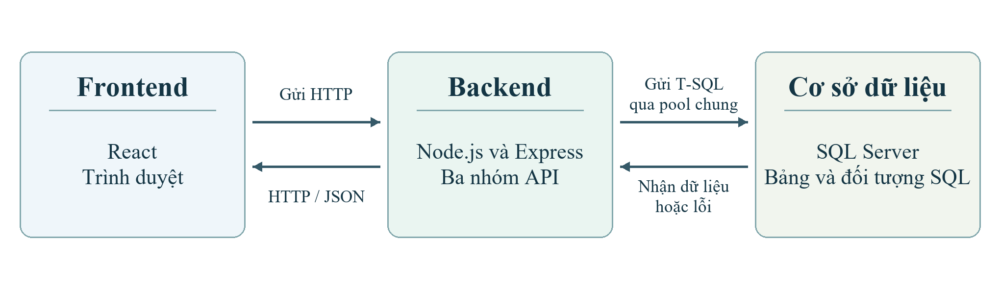

# 3.1. Mô tả công nghệ, cấu trúc source, kiến trúc

## 3.1.1. Công nghệ sử dụng

Ứng dụng Quản lý gọi món và đặt món dùng React cho giao diện, Express cho API và Microsoft SQL Server cho dữ liệu. Ba chức năng được hiện thực trong Phần 3 gồm quản lý danh mục món, quản lý món và size, và tổng hợp phân công theo ca.

| Công nghệ | Vai trò trong ứng dụng |
| --- | --- |
| React và React DOM 19.3.1, JavaScript, JSX, CSS | Hiển thị trang chủ và ba màn hình nghiệp vụ. Component React tiếp nhận thao tác, quản lý trạng thái tải, hiển thị bảng và thông báo. Các hàm gọi API sử dụng `fetch`. |
| Vite 6.4.6 | Chạy giao diện khi phát triển, đóng gói bản build và phục vụ bản xem trước. Trong môi trường tích hợp, Vite chuyển tiếp yêu cầu `/api` đến backend chung. |
| Node.js và Express 5.3.0 | Chạy một máy chủ HTTP cho ba nhóm API. Project yêu cầu Node.js từ 22.12.0 và đã được kiểm tra với 22.23.5. Express phân tích JSON, định tuyến yêu cầu và trả kết quả hoặc lỗi cho giao diện. |
| `mssql` 12.8.0 | Quản lý một pool kết nối dùng chung cho cả ba nhóm API và gắn tham số vào yêu cầu SQL. Cấu hình hỗ trợ SQL Auth qua Tedious hoặc Windows Auth qua `msnodesqlv8` và ODBC Driver 18. Môi trường demo sử dụng Windows Auth. |
| Microsoft SQL Server, T-SQL | Lưu dữ liệu trong các bảng quan hệ, dùng khóa và ràng buộc để duy trì tính toàn vẹn và thực thi truy vấn, thủ tục, trigger, hàm. Instance đã kiểm tra chạy SQL Server 2025 Express, CSDL thử `BTL2_P3_DEMO`. |

npm quản lý phụ thuộc theo `package-lock.json` của từng phần. Bộ kiểm thử backend dùng `node:test` để gửi yêu cầu HTTP qua Express và đối chiếu dữ liệu trên SQL Server.

## 3.1.2. Kiến trúc ba lớp Frontend, Backend và SQL Server

*Hình 3.1.1. Ba lớp của ứng dụng và giao tiếp giữa các lớp.*

| Lớp | Trách nhiệm |
| --- | --- |
| Frontend | Nhận thao tác người dùng, kiểm tra đầu vào phục vụ biểu mẫu, gửi HTTP đến `/api` và hiển thị dữ liệu hoặc thông báo từ backend. |
| Backend | Kiểm tra yêu cầu và gọi router nghiệp vụ. Ba router dùng chung một pool SQL Server. Backend chuyển dữ liệu hoặc lỗi SQL thành phản hồi HTTP theo hợp đồng của từng màn hình. |
| Cơ sở dữ liệu | Lưu dữ liệu và thực thi ràng buộc, thủ tục hoặc trigger khi xử lý lệnh. Các phép đếm của báo cáo phân công được thực hiện tại SQL Server. |

Khi chạy tích hợp trên cùng máy, ứng dụng React gọi đường dẫn tương đối `/api`. Vite dev hoặc preview chuyển tiếp yêu cầu đến Express tại `http://127.0.0.1:3001`. Khi chạy tách origin, giao diện có thể gọi thẳng địa chỉ backend theo cấu hình và Express kiểm tra origin bằng CORS.

| Yêu cầu | Luồng từ API đến SQL Server |
| --- | --- |
| Quản lý danh mục món | `/api/danh-muc-mon` đọc `dbo.DANH_MUC_MON` và gọi `usp_N1_ThemDanhMuc`, `usp_N2_CapNhatDanhMuc` hoặc `usp_N3_XoaDanhMuc` khi ghi. |
| Quản lý món và size | `/api/trigger-mon` đọc danh mục, món và size. Các thao tác ghi lên `dbo.MON` và `dbo.SIZE_MON` kích hoạt `trg_N2_Mon_TaoSizeMacDinh` và `trg_N2_Size_DungLoai` theo bảng và thao tác tương ứng. |
| Tổng hợp phân công theo ca | `/api/bao-cao/phan-cong-theo-ca` kiểm tra khoảng ngày rồi gọi `dbo.usp_N3_TongHopPhanCongTheoCa` với hai tham số `DATE`. Backend chuẩn hóa ngày giờ trước khi gửi kết quả. Pool đặt `useUTC: true` để việc chuyển sang chuỗi ISO giữ đúng ngày và giờ của ca. |

Endpoint `GET /api/health` chạy `SELECT 1` qua pool chung để kiểm tra khả năng truy vấn. Các hàm Phần 2.4 được kiểm chứng trên cùng CSDL thử bằng T-SQL.

Trình duyệt chỉ cần địa chỉ API và dữ liệu phục vụ hiển thị. Backend giữ cấu hình kết nối SQL Server, thực hiện kiểm tra phía máy chủ và quyết định truy vấn nào được phép chạy. Cách này tránh đưa thông tin kết nối vào mã gửi tới trình duyệt và giữ các quy tắc dữ liệu nhất quán dù yêu cầu đến từ màn hình hay công cụ kiểm thử HTTP. Mục 3.2 trình bày chi tiết các thao tác, kết quả và ảnh minh chứng của từng màn hình.

## 3.1.3. Cấu trúc mã nguồn thống nhất

### Thư mục và trách nhiệm

| Vị trí | Nội dung và trách nhiệm |
| --- | --- |
| `frontend/` | Giao diện React. Trong `src/`, `main.jsx` khởi tạo ứng dụng, `App.jsx` chọn màn hình, `pages/` chứa các trang, `components/` chứa các thành phần dùng lại, `styles/` chứa giao diện chung và `services/` chứa các hàm gọi API. `vite.config.js` cấu hình proxy. |
| `backend/` | Máy chủ Express. `src/server.js` đọc cấu hình và kiểm tra SQL Server trước khi lắng nghe. `src/app.js` ghép middleware và router. `test/integration.test.js` kiểm thử 12 endpoint nghiệp vụ và `/api/health` trên CSDL thử. |
| `database/` | Chứa script tổng hợp cấu trúc và dữ liệu mẫu, script bổ sung của Người 1, script kiểm tra đối tượng Phần 2 và script PowerShell dựng lại CSDL demo. `README.md` trong thư mục này ghi thứ tự nạp và kiểm tra. |

| Thư mục trong `backend/src/` | Quy ước tổ chức |
| --- | --- |
| `routes/` | Đăng ký phương thức HTTP và đường dẫn. `index.js` gắn ba nhóm route dưới `/api` và định nghĩa `/api/health`. |
| `controllers/` | Với danh mục món, controller đọc tham số và JSON, kiểm tra kiểu dữ liệu, gọi service và chuyển kết quả hoặc lỗi nghiệp vụ sang phản hồi HTTP. |
| `services/` | Service danh mục nhận pool chung, truy vấn bảng hoặc gọi thủ tục với tham số, rồi chuyển kết quả SQL sang trường dữ liệu của API. |
| `config/` | `load-env.js` nạp và kiểm tra cấu hình. `sql-server.js` chọn driver, quản lý pool dùng chung và cung cấp hàm `createQuery()` để gắn tham số truy vấn. |
| `middlewares/` | Xử lý CORS, trả JSON khi đường dẫn không tồn tại và chuẩn hóa lỗi do Express hoặc các route chuyển lên. |

Router danh mục đi theo luồng route → controller → service. Hai router món và size, báo cáo ca giữ phần kiểm tra đầu vào và xử lý phản hồi trong tệp route. Router món và size dùng `createQuery()`, còn router báo cáo lấy pool qua `getPool()`. Các giá trị gửi từ API xuống SQL được truyền qua tham số của driver.

### Quy ước phản hồi API

Các yêu cầu có phần thân JSON gửi tiêu đề `Content-Type: application/json`. Express giới hạn phần thân JSON ở 16 KB. Giao diện đọc mã trạng thái HTTP trước khi sử dụng trường `data` hoặc hiển thị lỗi.

| Trường hợp | Mã HTTP và cấu trúc phản hồi |
| --- | --- |
| Đọc hoặc cập nhật thành công | `200` và `{ "data": ... }`. `data` là mảng khi lấy danh sách hoặc báo cáo và là đối tượng khi cập nhật. |
| Tạo thành công | `201` và `{ "data": ... }`. |
| Xóa thành công | `204` với phần thân rỗng. |
| Danh mục, món và size gặp lỗi nghiệp vụ | `{ "error": { "code": ..., "message": "..." } }`. Ví dụ, mã danh mục trùng trả `409` với `error.code` là số `51007`. |
| Khoảng ngày báo cáo không hợp lệ | `400` với `code: "INVALID_DATE_RANGE"` và `message` ở cấp gốc. |
| Khoảng ngày hợp lệ nhưng không có ca | `200` với `data: []`, `code: "NO_SHIFTS"` và `message` ở cấp gốc. |
| Lỗi xử lý chung | JSON sai trả `400 / INVALID_REQUEST`, route không tồn tại trả `404 / NOT_FOUND`, lỗi nội bộ qua middleware trả `500 / SERVER_ERROR`. Mã và thông báo nằm trong `error`. |
| Kiểm tra kết nối | `GET /api/health` trả `200` với `{ "data": { "status": "ok", "database": "connected" } }` hoặc `503` với `error.code` là `DB_UNAVAILABLE`. |

Khi truy vấn thất bại ngoài các lỗi nghiệp vụ đã biết, router món và size trả `500 / DATABASE_ERROR` trong `error`. Router báo cáo trả `500 / REPORT_FAILED` với `code` và `message` ở cấp gốc. Mỗi phản hồi dùng thông báo dành cho người dùng và giữ thông tin kết nối ngoài phản hồi.

### Cấu hình môi trường và bảo mật

Backend nhận cấu hình từ `backend/.env`. Biến của tiến trình được ưu tiên khi trùng tên. Các giá trị kết nối như `DB_NAME`, `DB_AUTH`, `DB_USER` và `DB_PASSWORD` chỉ thuộc cấu hình phía máy chủ. Tệp mẫu `backend/.env.example` liệt kê tên biến và để trống thông tin đăng nhập SQL Auth. Cấu hình thử của nhóm dùng Windows Auth.

Frontend dùng `frontend/.env.local` để đặt `VITE_API_BASE_URL` khi gọi trực tiếp hoặc `VITE_API_PROXY_TARGET` khi chạy qua Vite proxy. Biến `VITE_API_BASE_URL` được đưa vào mã chạy trong trình duyệt, nên chỉ chứa địa chỉ API. `CORS_ORIGIN` được cấu hình ở backend theo danh sách origin của giao diện khi gọi khác origin.

Cả hai checkout có quy tắc `.gitignore` cho `.env` và `.env.*` với ngoại lệ `.env.example`. Tệp cấu hình thật được giữ trên máy chạy ứng dụng. Chỉ đưa tệp mẫu với giá trị công khai lên GitHub.
