# 3.2. Chi tiết hiện thực

## 3.2.1. Tổng quan giao diện chung và điều hướng ứng dụng

Ứng dụng Quản lý gọi món và đặt món tổ chức ba chức năng nghiệp vụ trong cùng một giao diện React. `AppLayout` cung cấp thanh điều hướng, vùng nội dung chính và liên kết **Về đầu trang**. `App` chọn màn hình theo đường dẫn hiện tại và đánh dấu mục tương ứng bằng `aria-current="page"`. Trên màn hình rộng, thanh điều hướng ghim ở đầu cửa sổ khi cuộn. Dưới 60 rem, menu chuyển sang hai cột để người dùng dễ chọn mục trên màn hình hẹp. Người dùng bàn phím có thể dùng liên kết **Đến nội dung chính** để bỏ qua menu.

Trang chủ giới thiệu phạm vi ứng dụng và có ba thẻ dẫn tới các màn hình nghiệp vụ. Mỗi thẻ mô tả thao tác chính và liệt kê thủ tục hoặc trigger tương ứng. Bộ đường dẫn được dùng chung cho menu và các thẻ trên trang chủ.

| Màn hình | Đường dẫn | Vai trò |
| --- | --- | --- |
| Trang chủ | `/` | Giới thiệu hệ thống và cung cấp ba lối tắt. |
| Quản lý danh mục món | `/danh-muc-mon` | Xem, thêm, sửa và xóa danh mục trong thực đơn. |
| Quản lý món và size | `/mon-va-size` | Thêm món, quản lý size và cập nhật trạng thái bán. |
| Tổng hợp phân công theo ca | `/phan-cong-theo-ca` | Chọn khoảng ngày để xem tình trạng và số liệu phân công theo ca. |

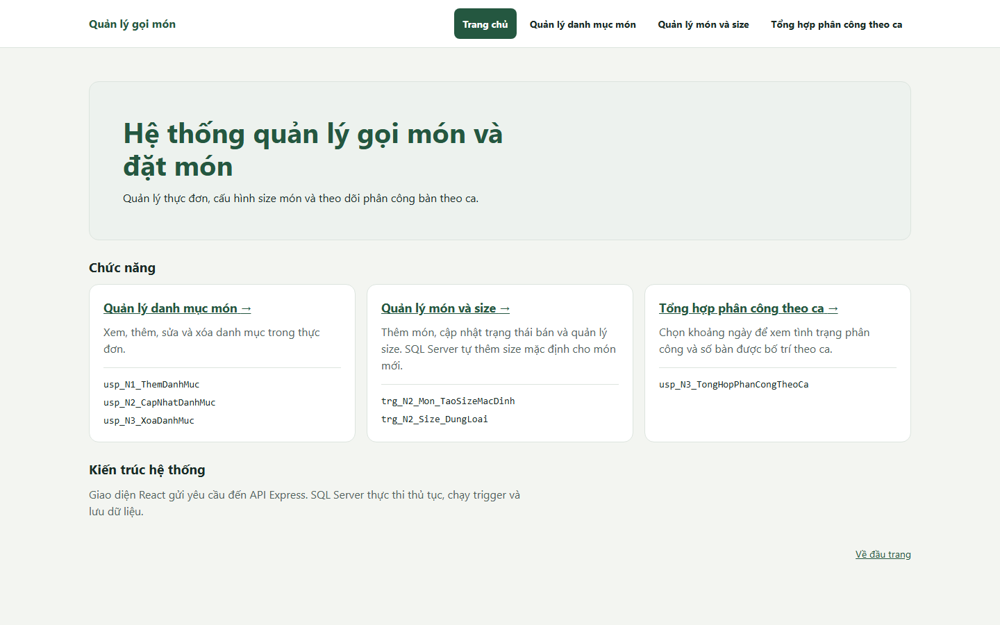

*Hình 3.2.1. Trang chủ của ứng dụng tích hợp. Ảnh chụp từ bản build chạy qua Vite Preview trong lần kiểm thử N4-24.*

### Quy chuẩn giao diện và thông báo

Các màn hình chia sẻ biến giao diện trong `theme.css`. Nền trang dùng màu `#f3f5f1`, khung nội dung dùng nền trắng, nút chính và mục menu hiện tại dùng màu xanh `#245740`. Tiêu đề, khoảng cách, góc bo và chiều cao điều khiển được thống nhất. Trên màn hình hẹp, các điều khiển có thể xuống dòng và bảng rộng cuộn ngang trong vùng riêng.

Thông báo thành công có nền xanh nhạt. Thông báo lỗi dùng chữ màu `#9b3025` trên nền đỏ nhạt và giải thích lỗi bằng văn bản. Trạng thái đang tải được hiển thị khi chờ API. Màn hình báo cáo có thông báo riêng nếu khoảng ngày đã chọn không có ca. Giao diện sử dụng `role="status"` cho các thông báo trạng thái phù hợp và `role="alert"` để trình đọc màn hình nhận biết lỗi.

### Luồng xử lý chung

React nhận thao tác và gửi yêu cầu HTTP đến API Express. Express gọi thủ tục hoặc thực hiện thao tác trên các bảng trong SQL Server, nơi các trigger được kích hoạt. Kết quả được trả về React để cập nhật bảng hoặc thông báo. Trong lần kiểm thử tích hợp, Vite chuyển tiếp yêu cầu tới ba API dùng chung cơ sở dữ liệu `BTL2_P3_DEMO`. Đã kiểm tra cả bốn màn hình trên Chrome ở chiều rộng 1440 px và 390 px.

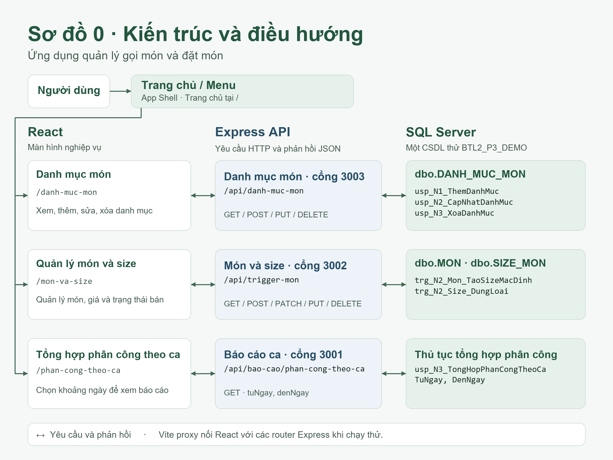

*Hình 3.2.2. Sơ đồ 0. Luồng điều hướng từ trang chủ và menu tới các màn hình nghiệp vụ, API tương ứng và SQL Server.*

## 3.2.2. Màn hình Yêu cầu 1 – Quản lý danh mục món

### Chức năng và thao tác

Màn hình `/danh-muc-mon` quản lý bảng `dbo.DANH_MUC_MON`. Danh sách hiển thị mã, tên và danh mục cha. Người dùng có thể xem dữ liệu ngay khi mở trang hoặc chọn **Tải lại**. Nếu danh mục không có cha, bảng hiển thị dấu gạch ngang.

- **Thêm danh mục.** Nhập mã, tên và chọn danh mục cha nếu có, rồi lưu.
- **Sửa danh mục.** Chọn dòng cần sửa để đổi tên hoặc danh mục cha. Mã danh mục chỉ đọc trong hộp thoại sửa.
- **Xóa danh mục.** Hộp thoại hiển thị tên và mã của dòng đã chọn. Chọn **Xoá danh mục** để gửi yêu cầu hoặc **Huỷ** để đóng hộp thoại và giữ nguyên dữ liệu.

### API và thủ tục SQL Server

| Thao tác | Yêu cầu HTTP | Đầu vào và kết quả thành công | Xử lý tại SQL Server |
| --- | --- | --- | --- |
| Xem danh sách | `GET /api/danh-muc-mon` | HTTP `200` với `{ data: [...] }`. | Đọc `MaDanhMuc`, `TenDanhMuc` và `MaDanhMucCha` từ `dbo.DANH_MUC_MON`, sắp theo tên rồi theo mã. |
| Thêm | `POST /api/danh-muc-mon` | JSON gồm `maDanhMuc`, `tenDanhMuc`, `maDanhMucCha`. HTTP `201` với `{ data: danhMuc }`. | `dbo.usp_N1_ThemDanhMuc` |
| Sửa | `PUT /api/danh-muc-mon/:maDanhMuc` | Lấy mã từ đường dẫn. JSON gồm `tenDanhMuc`, `maDanhMucCha`. HTTP `200` với `{ data: danhMuc }`. | `dbo.usp_N2_CapNhatDanhMuc` |
| Xóa | `DELETE /api/danh-muc-mon/:maDanhMuc` | Lấy mã từ đường dẫn. HTTP `204` với thân phản hồi rỗng. | `dbo.usp_N3_XoaDanhMuc` |

Khi bỏ trống danh mục cha, biểu mẫu gửi `maDanhMucCha: null`. Sau khi ghi thành công, React đóng hộp thoại, thông báo kết quả và gửi GET để tải lại bảng từ SQL Server. Khi SQL Server từ chối thao tác, API chuyển mã lỗi và thông báo sang `{ error: { code, message } }`. Giao diện giữ hộp thoại mở và hiển thị lỗi để người dùng điều chỉnh đầu vào.

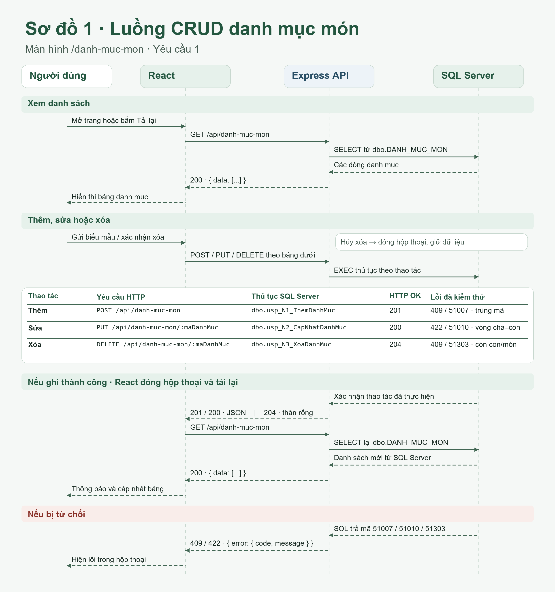

*Hình 3.2.3. Sơ đồ 1. Luồng đọc danh sách, gọi ba thủ tục ghi, tải lại sau khi thành công và hiển thị lỗi trong hộp thoại.*

### Kết quả kiểm thử

Các ca được thực hiện bằng Chrome qua Vite và API Người 1, dùng cơ sở dữ liệu thử `BTL2_P3_DEMO`. Ca N4-12 đến N4-15 đối chiếu giao diện, HTTP và dữ liệu SQL Server. N4-24 chạy lại bốn thao tác trên bản tích hợp chung.

| Ca kiểm thử | Đầu vào hoặc thao tác | Kết quả quan sát |
| --- | --- | --- |
| Xem và tải lại | Mở trang, sau đó bấm **Tải lại**. | GET trả `200`. Sáu dòng ban đầu khớp dữ liệu SQL Server. |
| Thêm hợp lệ | Nhập mã mới, tên hợp lệ và chọn một danh mục cha đã có. | POST trả `201`, sau đó GET trả `200`. Dòng mới hiển thị đúng tên và danh mục cha. |
| Thêm trùng mã | Dùng lại mã đã tồn tại. | HTTP `409`, SQL `51007`. Hộp thoại báo trùng mã và giữ đầu vào. Dữ liệu giữ nguyên. |
| Sửa hợp lệ | Sửa tên và đổi sang danh mục cha hợp lệ. | PUT trả `200`, sau đó GET trả `200`. Bảng hiển thị tên và danh mục cha mới. |
| Sửa tạo vòng cha–con | Chọn một danh mục con làm cha của danh mục đang sửa. | HTTP `422`, SQL `51010`. Giao diện hiện lỗi vòng lặp. SQL Server giữ dữ liệu như trước thao tác. |
| Hủy xóa | Mở hộp thoại xóa rồi chọn **Huỷ**. | Hộp thoại đóng, số dòng giữ nguyên và không phát sinh DELETE. |
| Xóa hợp lệ | Xác nhận xóa danh mục thử không có danh mục con hay món tham chiếu. | DELETE trả `204`, sau đó GET trả `200`. Dòng biến mất trên bảng và trong SQL Server. |
| Xóa còn dữ liệu phụ thuộc | Lần lượt xác nhận xóa một danh mục còn danh mục con và một danh mục còn món. | Cả hai lần trả HTTP `409`, SQL `51303`. Hộp thoại hiện nguyên nhân và dữ liệu giữ nguyên. |

### Ảnh minh chứng trước và sau thao tác

Bốn ảnh sau được chụp trên bản tích hợp trong N4-24. Chuỗi ảnh theo dõi cùng danh mục thử `N424_BADB4504_DM` từ khi thêm đến khi xóa.

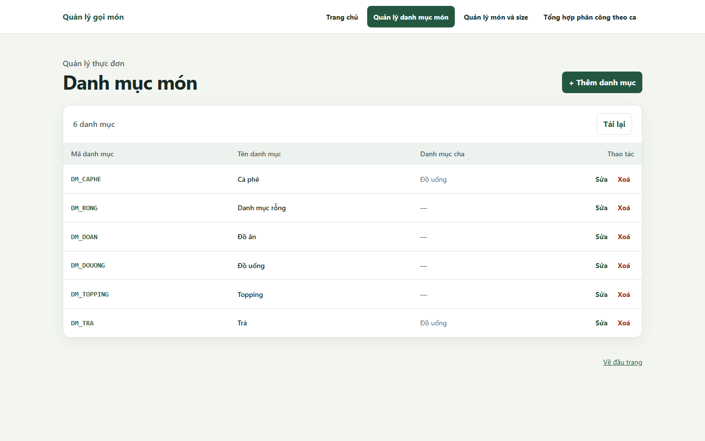

*Hình 3.2.4. Trước khi thêm. Danh sách hiển thị sáu danh mục.*

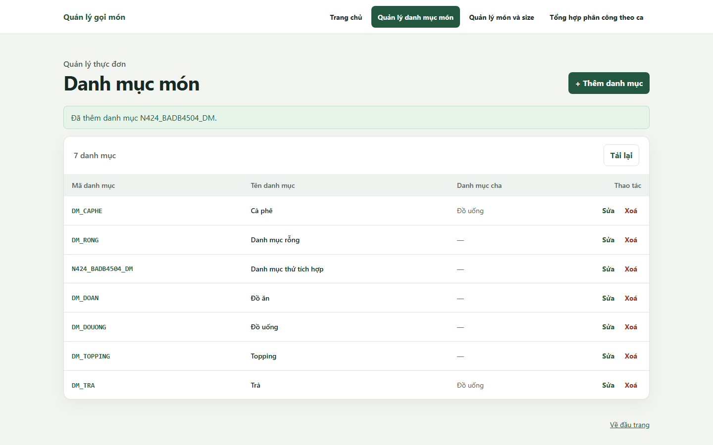

*Hình 3.2.5. Sau khi thêm. Mã thử xuất hiện trong bảng và số dòng tăng lên bảy.*

*Hình 3.2.6. Sau khi sửa. Tên dòng thử đổi thành “Danh mục thử đã sửa”.*

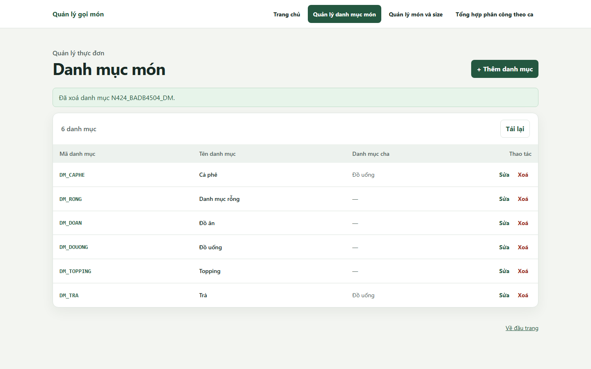

*Hình 3.2.7. Sau khi xóa. Dòng thử biến mất và danh sách trở về sáu dòng ban đầu.*

Ba ảnh lỗi dưới đây được chụp trên cùng giao diện tích hợp ở N4-35. API trả mã lỗi tương ứng, hộp thoại giữ nguyên đầu vào và dữ liệu trong SQL Server được giữ nguyên.

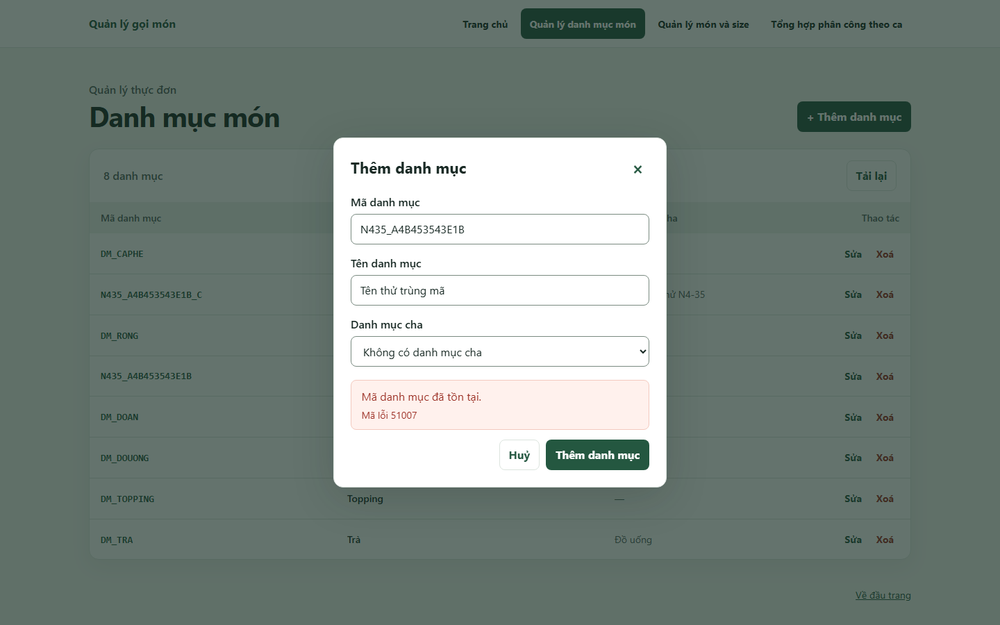

*Hình 3.2.8. Khi thêm mã danh mục đã tồn tại, API trả HTTP 409 và hộp thoại hiển thị lỗi 51007.*

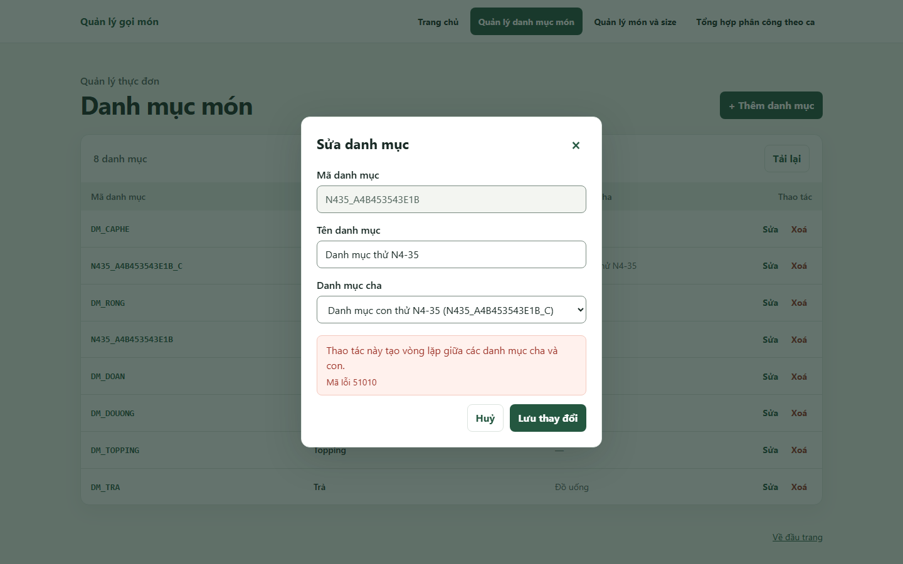

*Hình 3.2.9. Khi chọn danh mục con làm cha, API trả HTTP 422 và hộp thoại hiển thị lỗi 51010.*

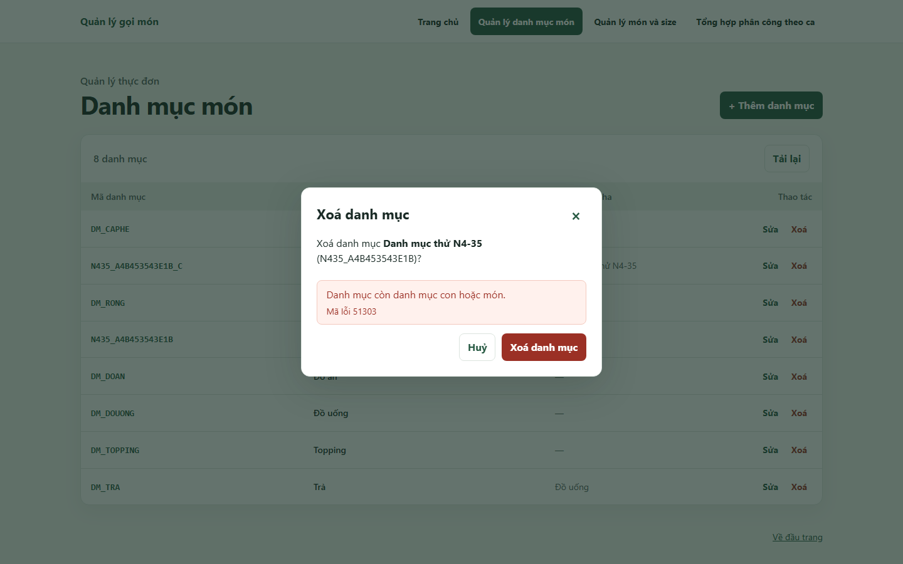

*Hình 3.2.10. Khi danh mục còn danh mục con, API trả HTTP 409 và hộp thoại hiển thị lỗi 51303.*

## 3.2.3. Màn hình Yêu cầu 2 – Quản lý món và size

### Chức năng và thao tác

Màn hình `/mon-va-size` gồm biểu mẫu **Thêm món**, bảng **Danh sách món** và khung chi tiết size. Người dùng nhập mã, tên, loại, danh mục và trạng thái bán để tạo món. Sau khi thêm thành công, giao diện chọn món mới để hiển thị size mặc định. Với món đã có, nút **Xem size** mở bảng giá và trạng thái của từng size. Từ khung này, người dùng có thể thêm size, sửa giá hoặc trạng thái, xác nhận xóa size và bật hoặc ngừng bán món.

### API và xử lý tại SQL Server

Các đường dẫn trong bảng cùng có tiền tố `/api/trigger-mon`. `:maMon` và `:maSize` xác định món và size cần thao tác.

| Thao tác | Yêu cầu HTTP | Dữ liệu gửi | Kết quả thành công và xử lý SQL |
| --- | --- | --- | --- |
| Đọc danh mục | `GET /danh-muc` | Không cần đầu vào. | `200` và mảng `data` từ `dbo.DANH_MUC_MON`. |
| Đọc món và size | `GET /mon` | Không cần đầu vào. | `200` và mảng `data`. API ghép món, danh mục và các size từ `dbo.MON`, `dbo.DANH_MUC_MON` và `dbo.SIZE_MON`. |
| Thêm món | `POST /mon` | `maMon`, `tenMon`, `loaiMon`, `maDanhMuc`, `trangThaiKinhDoanh`. | `201`. Chèn dòng vào `dbo.MON` và SQL Server tự tạo size mặc định. |
| Đổi trạng thái bán của món | `PATCH /mon/:maMon/trang-thai` | `trangThaiKinhDoanh`. | `200`. Cập nhật trạng thái trong `dbo.MON`. |
| Thêm size | `POST /mon/:maMon/size` | `maSize`, `giaBan`, `trangThaiSize`. | `201`. Chèn dòng vào `dbo.SIZE_MON`. |
| Sửa size | `PUT /mon/:maMon/size/:maSize` | `giaBan`, `trangThaiSize`. | `200`. Cập nhật giá và trạng thái trong `dbo.SIZE_MON`. |
| Xóa size | `DELETE /mon/:maMon/size/:maSize` | Mã món và mã size trong đường dẫn. | `204` với thân phản hồi rỗng. Xóa dòng trong `dbo.SIZE_MON`. |

- **`dbo.trg_N2_Mon_TaoSizeMacDinh`** chạy sau INSERT hoặc UPDATE trên `dbo.MON`. Món mới ở trạng thái Ngừng bán được tạo size `S` nếu là đồ ăn hoặc đồ uống, và size `TC` nếu là topping. Size ban đầu có giá 0 đồng và ở trạng thái Ngừng bán. SQL trả `51210` nếu tạo món ở trạng thái Đang bán, hoặc `51212` nếu bật bán một món chưa có size đang bán.
- **`dbo.trg_N2_Size_DungLoai`** chạy sau INSERT, UPDATE hoặc DELETE trên `dbo.SIZE_MON`. Topping dùng `TC`. Đồ ăn và đồ uống dùng `S`, `M` hoặc `L`. SQL trả `51213` khi size sai loại và `51212` nếu tắt hoặc xóa size đang bán cuối cùng của một món đang bán.

Khi SQL Server từ chối ghi, API trả `{ error: { code, message } }`. Giao diện hiển thị thông báo cùng mã lỗi. Sau mỗi yêu cầu ghi được gửi đi, giao diện gọi lại hai GET để cập nhật danh mục, món và size. Nếu chọn **Hủy** ở bước xác nhận xóa, giao diện giữ nguyên size và không gửi DELETE.

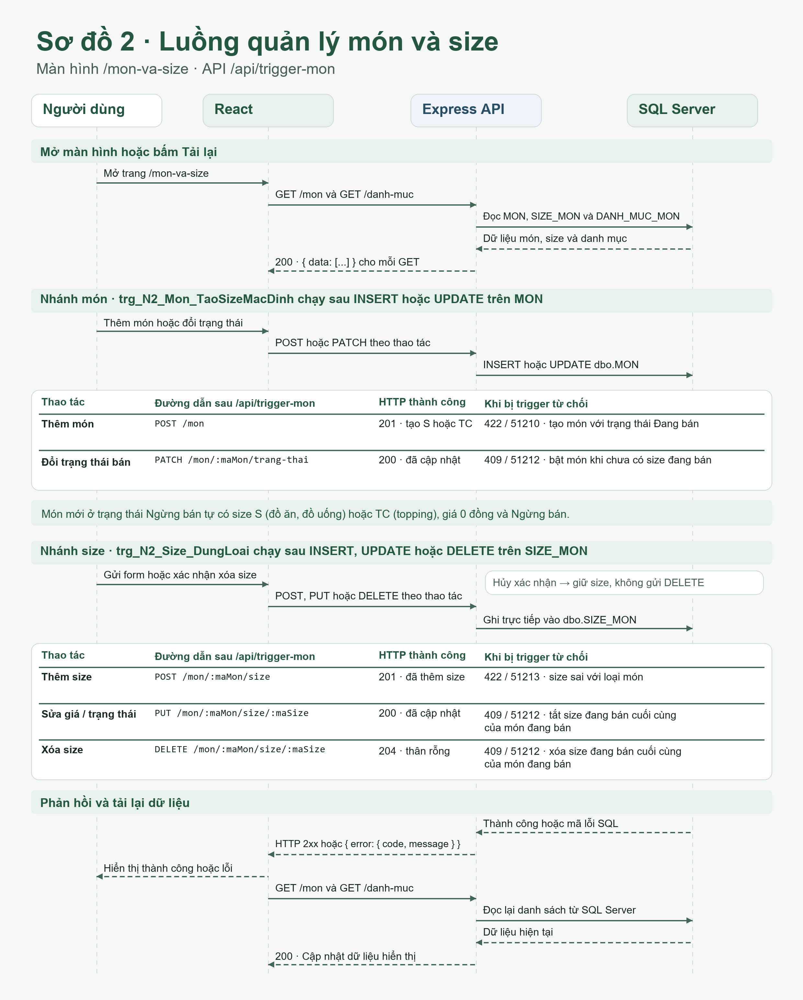

*Hình 3.2.11. Sơ đồ 2. Thao tác trên `MON` và `SIZE_MON` kích hoạt hai trigger tương ứng. Sơ đồ thể hiện phản hồi HTTP và bước tải lại dữ liệu.*

### Kết quả kiểm thử

Các ca N4-18, N4-19 và N4-24 chạy bằng Chrome qua Vite, API Người 2 và cơ sở dữ liệu thử `BTL2_P3_DEMO`. Kết quả dưới đây được đối chiếu với dữ liệu trong SQL Server.

| Ca kiểm thử | Thao tác | Kết quả quan sát |
| --- | --- | --- |
| Tạo món đang bán | Thêm món với trạng thái Đang bán. | HTTP `422`, SQL `51210`. Giao diện hiện lỗi và không phát sinh món hoặc size. |
| Tạo món ngừng bán | Lần lượt thêm đồ ăn, đồ uống và topping ở trạng thái Ngừng bán. | Cả ba lần trả `201`. SQL Server tự tạo `S`, `S`, `TC` tương ứng. Cả ba size có giá 0 đồng và ở trạng thái Ngừng bán. |
| Bật món khi chưa có size đang bán | Chọn **Bật bán món** khi size mặc định vẫn ngừng bán. | HTTP `409`, SQL `51212` từ trigger trên `MON`. Trạng thái món giữ nguyên. |
| Sửa size và bật món | Đổi giá size `S` thành 25.000 đồng, đặt size ở trạng thái Đang bán, rồi bật món. | PUT và PATCH đều trả `200`. Giá và trạng thái mới trên giao diện khớp SQL Server. |
| Thêm size sai loại | Thử thêm `M` cho topping và `TC` cho đồ uống. | Cả hai lần trả HTTP `422`, SQL `51213`. Danh sách size giữ nguyên. |
| Tắt hoặc xóa size đang bán cuối cùng | Lần lượt tắt và xác nhận xóa size đang bán duy nhất của món đang bán. | PUT và DELETE đều trả HTTP `409`, SQL `51212` từ trigger trên `SIZE_MON`. Size vẫn đang bán. |
| Hủy xác nhận xóa | Bấm **Hủy** khi được hỏi xác nhận xóa size `M`. | Size `M` vẫn còn và giao diện không gửi DELETE. |
| Xóa hợp lệ | Xác nhận xóa size `M` khi món vẫn còn size `S` đang bán. | DELETE trả `204`. Sau khi tải lại, size `M` biến mất và size `S` vẫn đang bán. |

### Ảnh minh chứng

Ba ảnh đầu theo dõi cùng một món thử trên bản tích hợp N4-24. Các ảnh tiếp theo trích từ các ca kiểm thử riêng trên cùng màn hình ở N4-18 và N4-19.

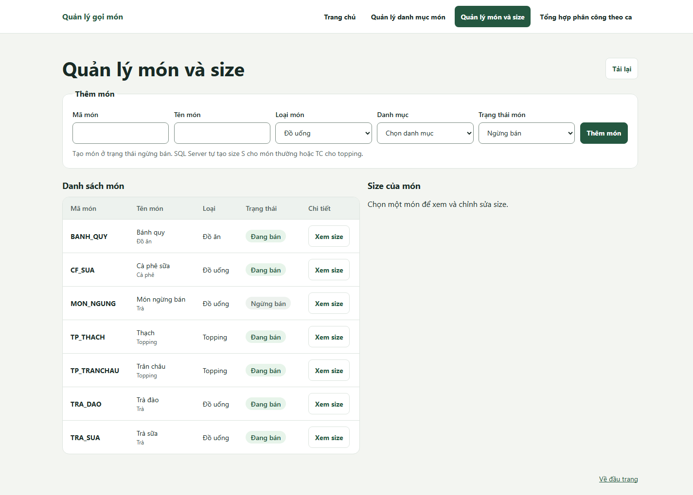

*Hình 3.2.12. Trước khi thêm món thử. Danh sách hiển thị bảy món ban đầu.*

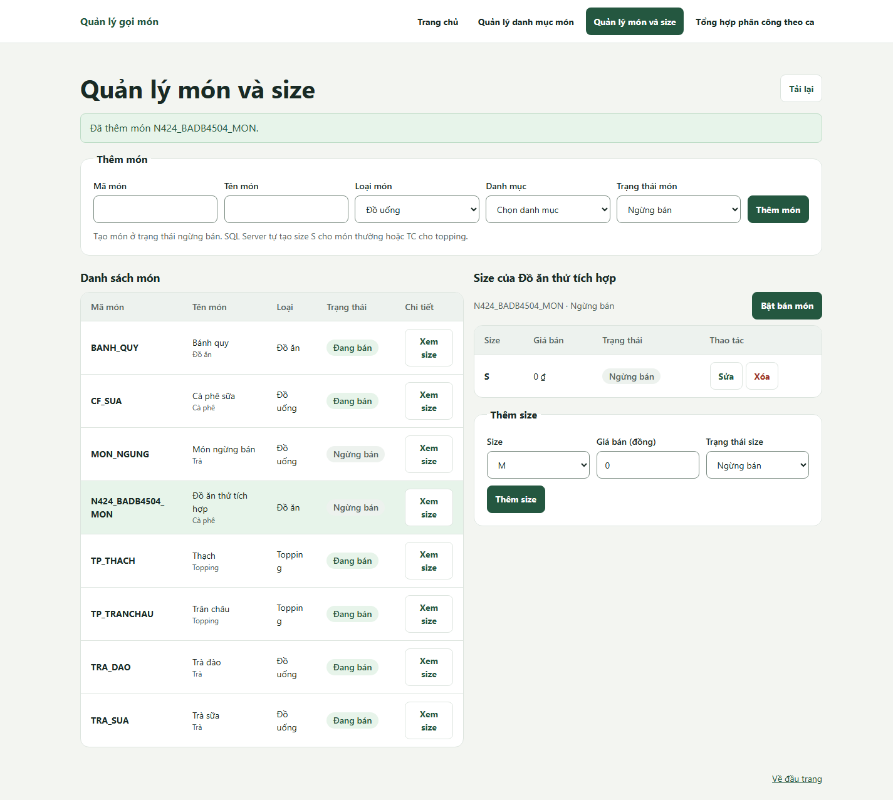

*Hình 3.2.13. Sau khi thêm đồ ăn ở trạng thái Ngừng bán. SQL Server tự tạo size S giá 0 đồng.*

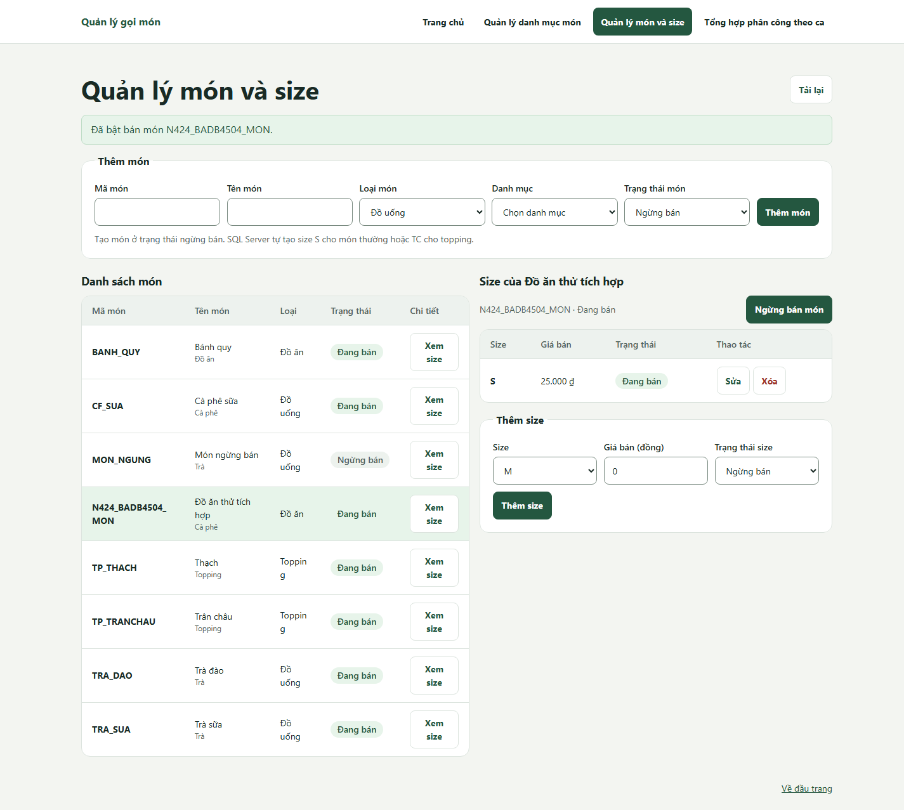

*Hình 3.2.14. Sau khi cập nhật giá và bật bán size S, món được bật bán thành công.*

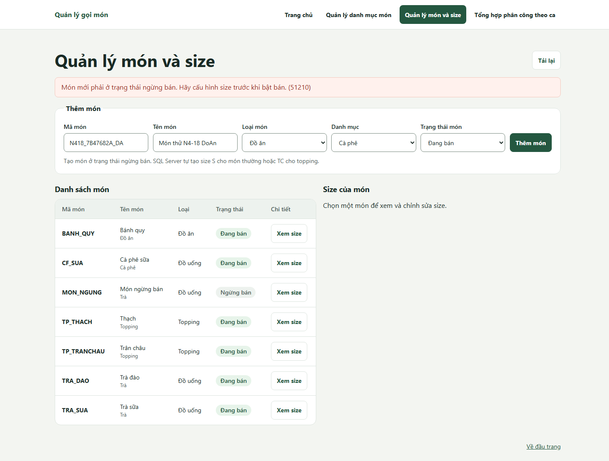

*Hình 3.2.15. Trigger trên MON chặn việc tạo món ở trạng thái Đang bán với mã 51210.*

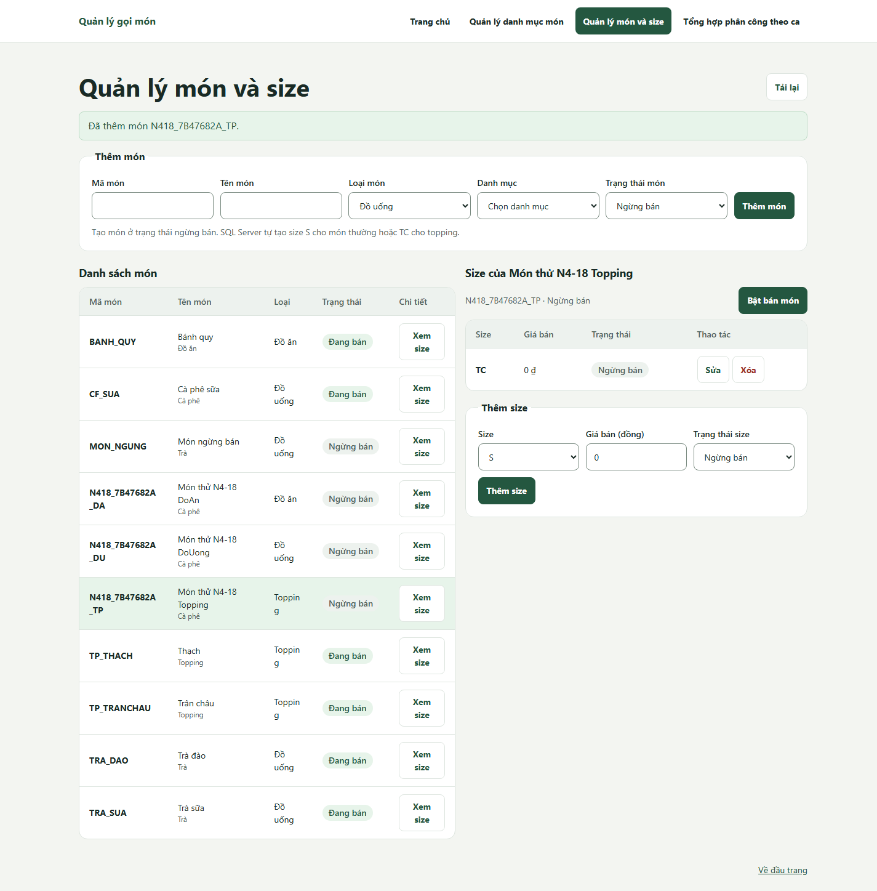

*Hình 3.2.16. Topping ở trạng thái Ngừng bán được tạo size TC mặc định.*

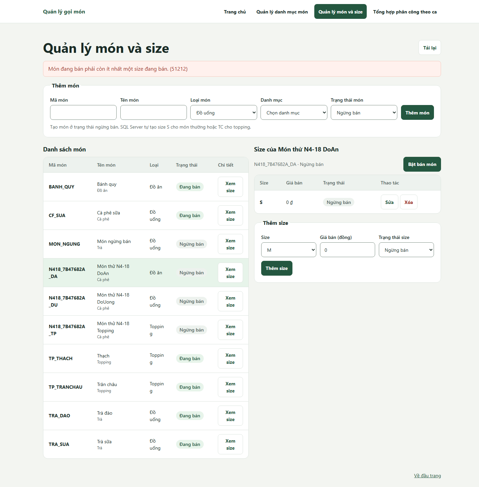

*Hình 3.2.17. Trigger trên MON chặn bật món khi chưa có size đang bán với mã 51212.*

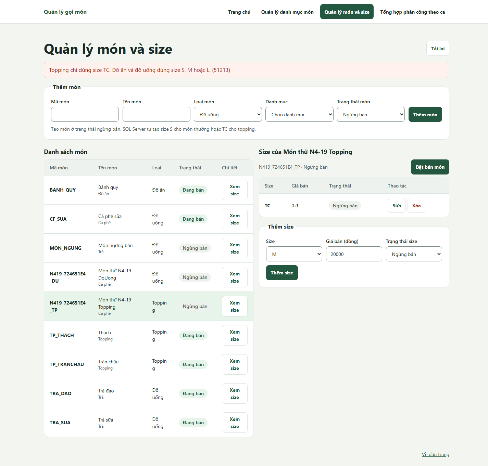

*Hình 3.2.18. Kiểm thử trigger với size sai loại trước khi bổ sung bộ lọc giao diện. Bản hiện tại chỉ hiện size hợp lệ chưa có trong ô Thêm size. Ca gửi size sai loại được kiểm tra qua API.*

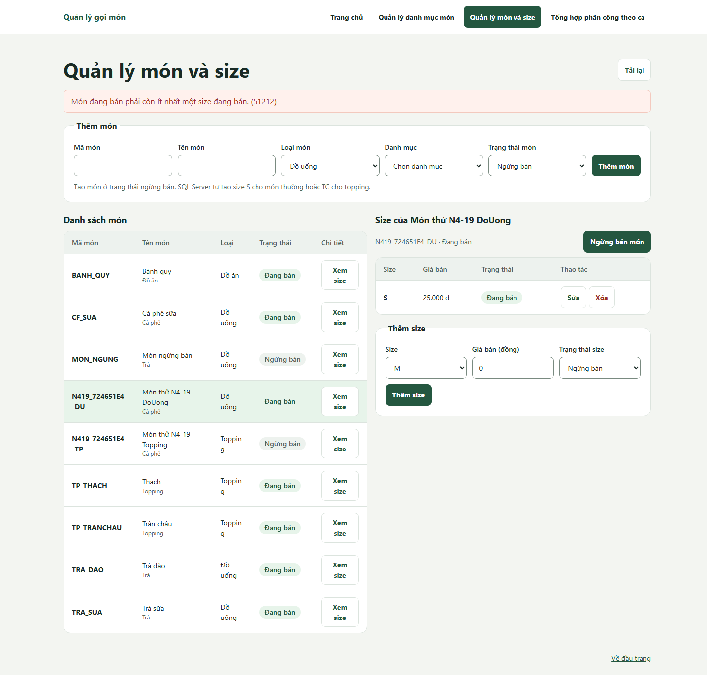

*Hình 3.2.19. Trigger trên SIZE_MON chặn xóa size đang bán cuối cùng của món đang bán với mã 51212.*

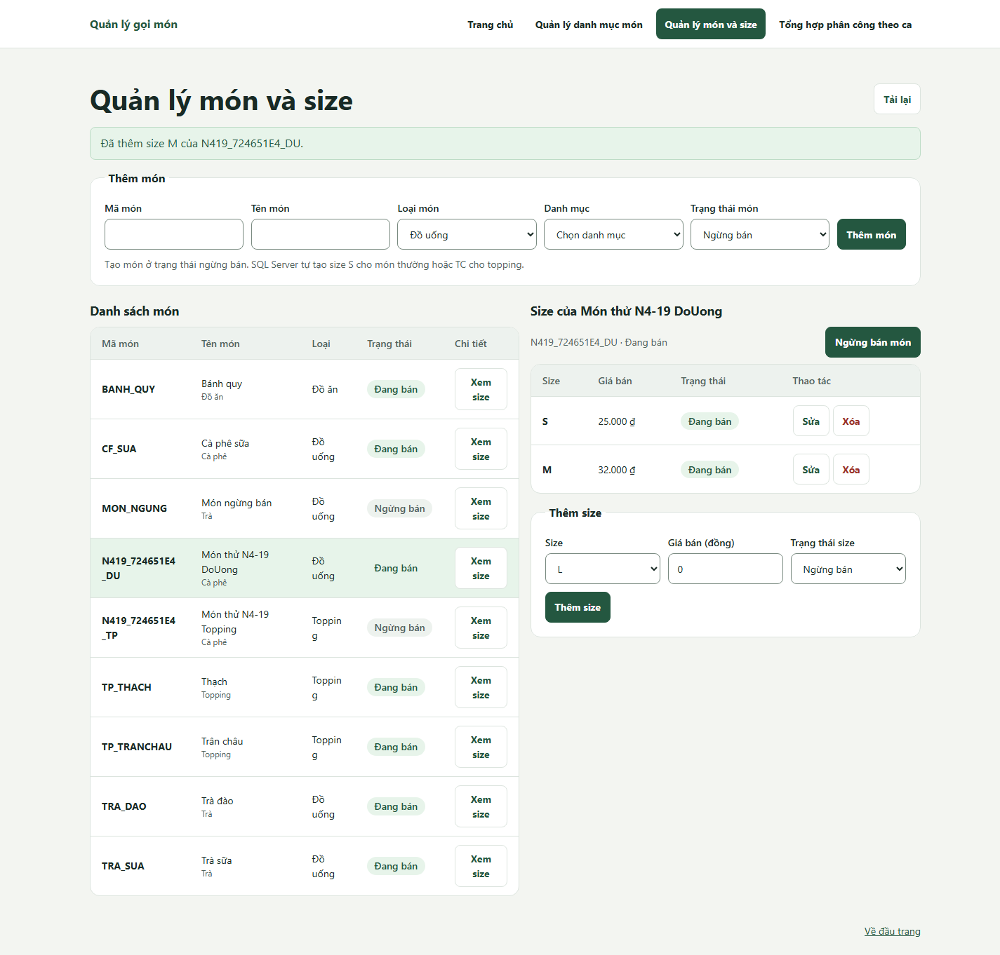

*Hình 3.2.20. Trước khi xóa hợp lệ. Món có hai size S và M đang bán.*

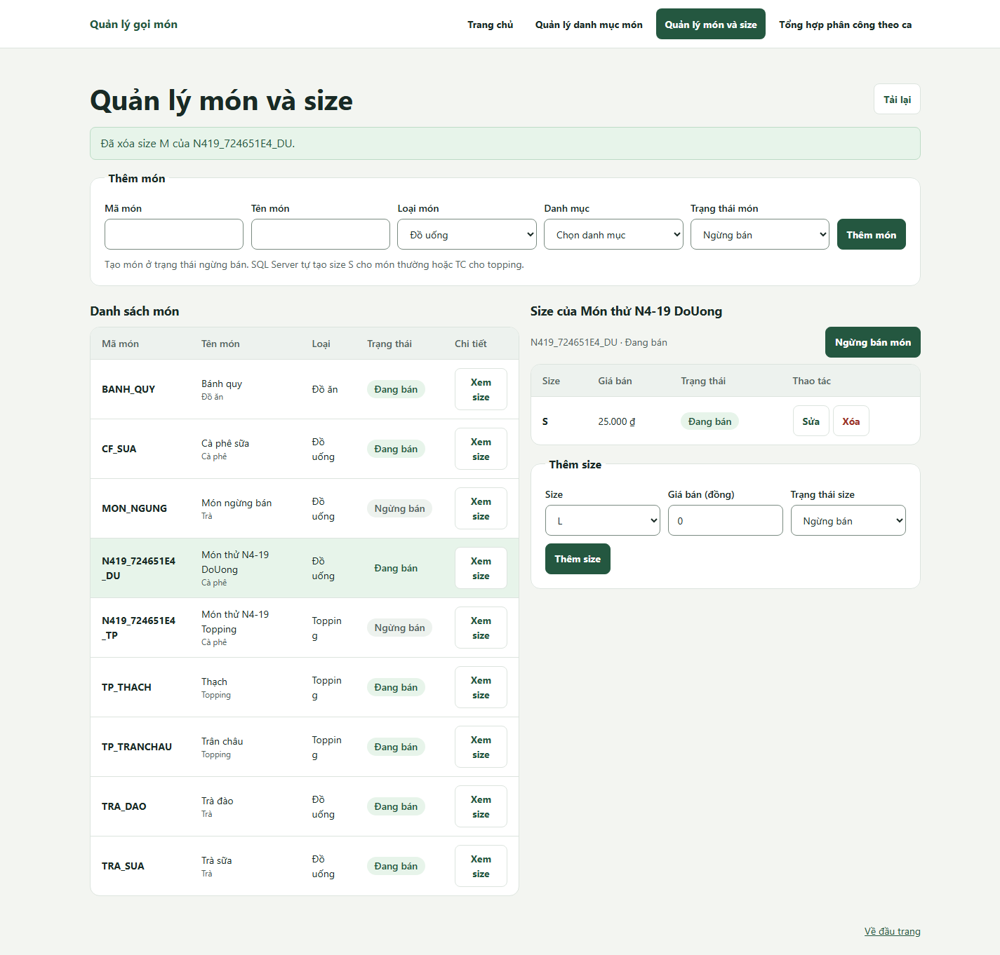

*Hình 3.2.21. Sau khi xóa hợp lệ. Giao diện xác nhận đã xóa size M và còn size S đang bán.*

## 3.2.4. Màn hình Yêu cầu 3 – Tổng hợp phân công theo ca

### Chức năng và thao tác

Màn hình `/phan-cong-theo-ca` cho phép tra cứu tình trạng phân công bàn trong một khoảng ngày. Người dùng chọn **Từ ngày**, **Đến ngày**, rồi bấm **Xem báo cáo**. Khi chờ kết quả, giao diện hiển thị trạng thái đang tải và tạm khóa biểu mẫu. Nếu truy vấn có dữ liệu, mỗi dòng trong bảng tương ứng với một ca làm và có nhãn **Đã phân công** hoặc **Chưa phân công**.

### API, đầu vào và kết quả

Giao diện gửi `GET /api/bao-cao/phan-cong-theo-ca` với hai tham số truy vấn `tuNgay` và `denNgay` theo định dạng `YYYY-MM-DD`. Express kiểm tra hai ngày có hợp lệ và ngày đầu không sau ngày cuối. Nếu hợp lệ, API truyền hai giá trị vào tham số `@TuNgay DATE` và `@DenNgay DATE` của thủ tục `dbo.usp_N3_TongHopPhanCongTheoCa` ở mục 2.3.a.

Thủ tục lấy các ca trong `dbo.CA_LAM` thuộc khoảng ngày đã chọn, tính cả hai ngày đầu và cuối. Với từng ca, thủ tục đọc `dbo.PHAN_CONG` để đếm số nhân viên và số bàn phân biệt, đồng thời đếm tổng số lượt phân công. Ca không có lượt phân công vẫn xuất hiện với các số đếm bằng 0 và tình trạng **Chưa phân công**. Kết quả được sắp theo ngày làm, giờ bắt đầu và mã ca.

| Nhóm dữ liệu | Trường trong kết quả |
| --- | --- |
| Thông tin ca | `MaCa`, `NgayLam`, `GioBatDau`, `GioKetThuc` |
| Số liệu phân công | `SoNhanVienPhucVu`, `SoBanDuocPhanCong`, `SoLuotPhanCong` |
| Tình trạng | `TinhTrang` |

API chuẩn hóa ngày theo `YYYY-MM-DD` và giờ theo `HH:mm:ss` trước khi trả dữ liệu. React chuyển ngày sang `DD/MM/YYYY` trong bảng và hiển thị các số đếm đã được tính ở SQL Server. Nếu khoảng ngày sai, Express trả `400` với `INVALID_DATE_RANGE` trước khi gọi thủ tục. Nếu khoảng ngày hợp lệ nhưng không có ca, thủ tục báo `51312` và API trả `200` với `data: []`, `code: "NO_SHIFTS"` và thông báo.

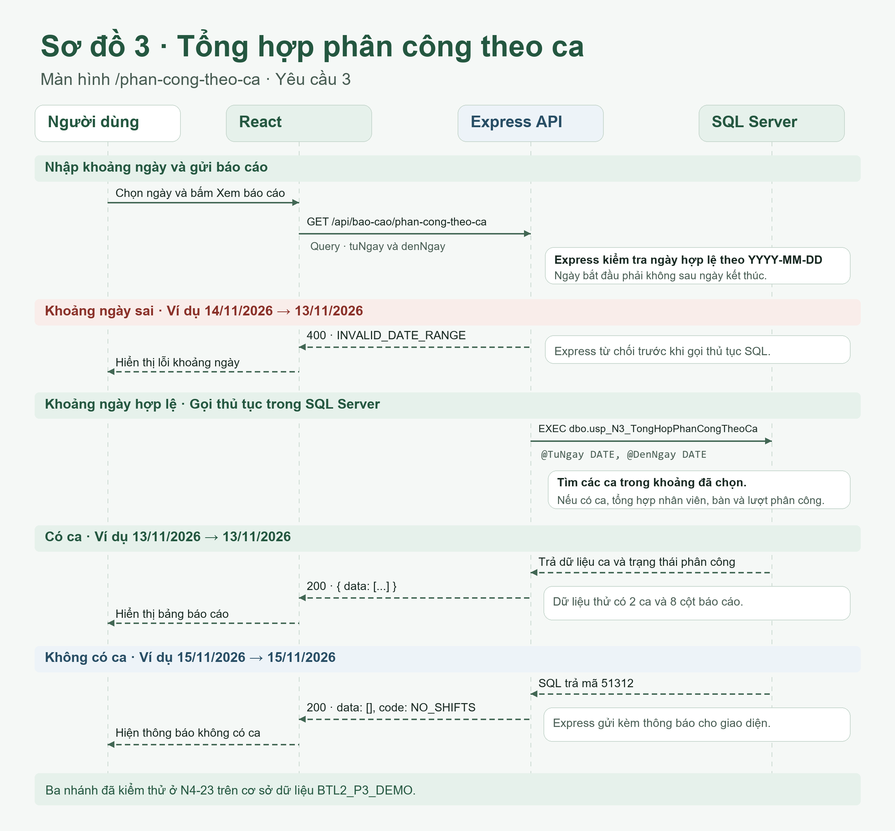

*Hình 3.2.22. Sơ đồ 3. Luồng kiểm tra khoảng ngày và trả kết quả khi có ca, ngày sai hoặc không có ca.*

### Kết quả kiểm thử và ảnh minh chứng

Ba ca N4-23 chạy trên Chrome qua Vite, API Người 3 và cơ sở dữ liệu thử `BTL2_P3_DEMO`. Ca có dữ liệu được đối chiếu với kết quả gọi trực tiếp thủ tục SQL.

| Ca kiểm thử | Từ ngày → đến ngày | HTTP và SQL | Kết quả trên giao diện |
| --- | --- | --- | --- |
| Có dữ liệu | 13/11/2026 → 13/11/2026 | HTTP `200`, thủ tục trả hai ca. | Tám cột khớp SQL Server. Ca sáng đã phân công, ca chiều chưa phân công. |
| Khoảng ngày không hợp lệ | 14/11/2026 → 13/11/2026 | HTTP `400`, `INVALID_DATE_RANGE`. Express từ chối trước khi gọi thủ tục. | Hiện thông báo yêu cầu chọn ngày bắt đầu không sau ngày kết thúc. |
| Không có ca | 15/11/2026 → 15/11/2026 | SQL `51312`. API trả HTTP `200` với `NO_SHIFTS` và mảng rỗng. | Hiện “Không có ca làm trong khoảng ngày đã chọn.” |

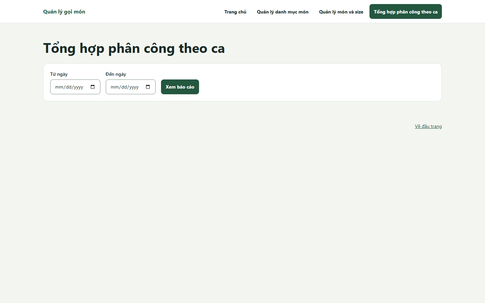

*Hình 3.2.23. Màn hình Tổng hợp phân công theo ca lúc mới mở trong lần kiểm thử tích hợp N4-24. Hai ô ngày đang trống.*

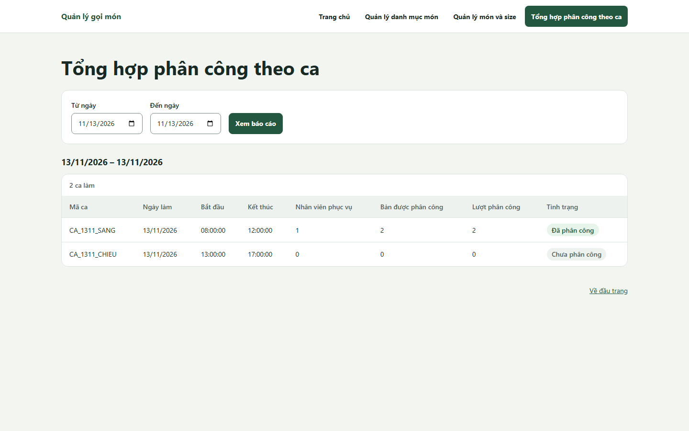

*Hình 3.2.24. Báo cáo ngày 13/11/2026. Ca sáng có 1 nhân viên phục vụ, 2 bàn và 2 lượt phân công. Ba số đếm của ca chiều đều bằng 0.*

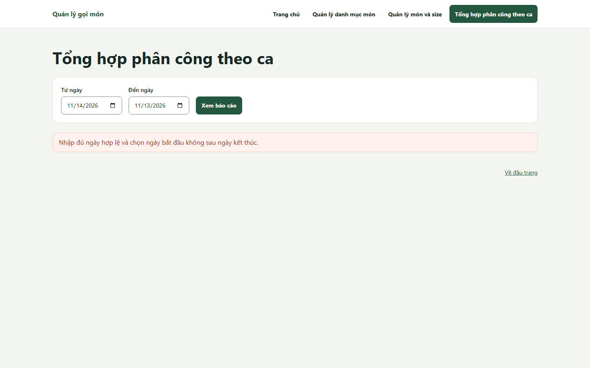

*Hình 3.2.25. Khoảng ngày nhập theo thứ tự đảo. Giao diện hiển thị lỗi do Express trả về.*

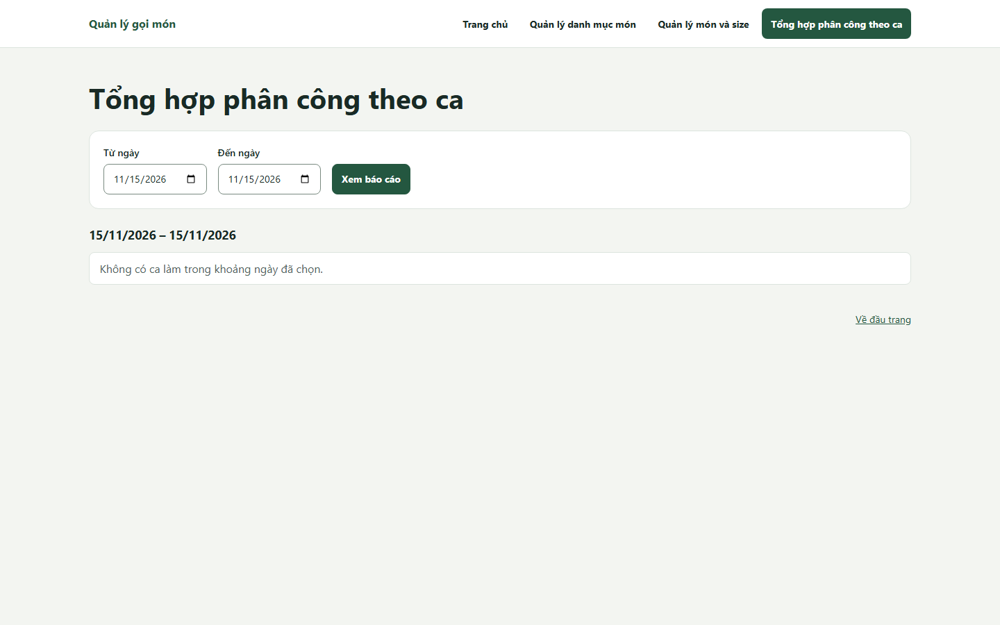

*Hình 3.2.26. Báo cáo ngày 15/11/2026. Khoảng ngày hợp lệ và giao diện thông báo không có ca làm.*
